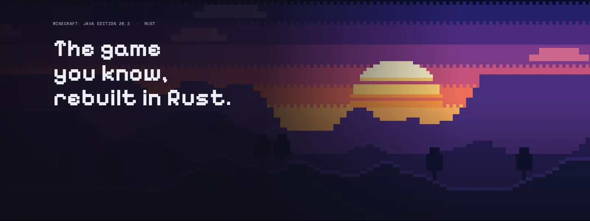

<p align="center">
  
</p>

<p align="center">
  
  
  
  <a href="LICENSE"></a>
</p>

# Horizon Server

Horizon Server is a dedicated server for Minecraft: Java Edition 26.3, written in Rust. Vanilla clients join it like any Java server: same worlds, same rules, same terrain, no Java on the machine.

It is a server-only fork of [Horizon](https://github.com/horizon-rust/horizon) by Ludovic Marie and the Horizon contributors. This repository is about the server alone: the client, the launcher and their releases are not maintained here. The source tree stays whole because the server runs on Horizon's game engine, but everything is built, tested and documented for hosting.

> Not an official Minecraft product. Not approved by or associated with Mojang or Microsoft. Horizon Server contains no Minecraft code, assets or data: you need your own legally obtained copy of Minecraft: Java Edition 26.3 (the server jar) to prepare its files.

## What this fork adds

Everything upstream Horizon's dedicated server does, plus:

| Area | What |
| --- | --- |
| Plugins | Sandboxed WebAssembly plugins anyone can write ([docs/plugins.md](docs/plugins.md)); the official ones come with each release |
| Spawn | Plugin [`spawn`](plugins/spawn): `/setspawn` (operators) sets the spawn spot; `/spawn` (everyone) takes you there after a 5 second countdown in the action bar that moving cancels |
| Spawn elytra | Plugin [`elytra`](plugins/elytra): `/spawnelytra pos1` and `pos2` mark a region: falling or jumping off inside it starts a glide without an elytra, `F` boosts once, no fall damage on landing. Made for a spawn island in the sky |
| Dimensions | `/dimension nether on\|off` and `/dimension end on\|off` close or open the Nether and the End |
| Voice chat | Plugin [`voice`](plugins/voice): a server for the [Simple Voice Chat](https://modrinth.com/plugin/simple-voice-chat) mod: proximity voice, whispering, and groups (normal, open, isolated, with passwords) |
| Stats page | Plugin [`stats`](plugins/stats): a live web page with every player's statistics, top-10 boards and a page per player, AFK time included, in English or German |
| Server tools | `/tps` (tick rate, MSPT, players, loaded chunks); `horizon-server console` attaches to a running server |
| Fixes | Ender pearls through End gateways; a neutral mob stays angry at the player who provoked it only; the hurt sound reaches the other players once; PvP death messages name the attacker; no TNT ghost blocks; `x_rotation`/`y_rotation` in selectors; shulker box tooltips; guests' deaths, jumps and crafted items are counted |

## Plugins

Anyone can extend the server with plugins: sandboxed WebAssembly, one folder each in `plugins/`
(`plugins/<name>/<plugin>.hmod`, its data in `plugins/<name>/data/`). They add commands, hear
joins, chat and block changes, message and teleport players, read and set blocks, each only as
far as the capabilities its manifest asks for. Installing and writing one:
[docs/plugins.md](docs/plugins.md).

## Ports

| Port | Protocol | What | Change it with |
| --- | --- | --- | --- |
| 25565 | TCP | The game | `server-port` in `server.toml` |
| 24454 | UDP | Simple Voice Chat (plugin `voice`) | `plugins/voice/data/port` |
| 8100 | TCP | The stats page (`http://<server>:8100`, plugin `stats`) | `plugins/stats/data/port` |

The stats page speaks English; `de_de` (any game language code) in `plugins/stats/data/lang` switches its item, block and mob names, and its own words to German for `de_*`.

Open the ones you use in your firewall. Both start with the server, when their plugin is installed. A plugin's settings are plain text files in its `data/` folder: change one, then restart.

## Commands

| Command | Who | What |
| --- | --- | --- |
| `/spawn` | Everyone | Teleport to the spawn after 5 seconds standing still (plugin `spawn`) |
| `/setspawn` | Operators | The spawn spot is where you stand, looking where you look (plugin `spawn`) |
| `/spawnelytra pos1` / `pos2` | Operators | The corners of the spawn elytra region, at your feet (plugin `elytra`) |
| `/spawnelytra off` | Operators | Remove the region; `/spawnelytra` alone shows it (plugin `elytra`) |
| `/dimension nether\|end on\|off` | Operators | Open or close a dimension |
| `/tps` | Everyone | Tick rate, MSPT, players and loaded chunks |

The settings these commands write live next to the world (`horizon-dimensions.json`, the End) or in their plugin's `data/` folder (the spawn, the spawn elytra region, the AFK times). The Nether switch is the vanilla game rule `allow_entering_nether_using_portals`.

## Host it

The hosting guide covers installing, preparing the game files, `server.toml`, the commands, the web panel, backups, autostart and Docker: [docs/hosting.md](docs/hosting.md).

## Build from source

Requirements: Rust 1.90 or newer, Python 3.10 or newer, JDK 25 (only to prepare the game files), and on Linux the ALSA and udev development headers (`libasound2-dev libudev-dev` on Debian and Ubuntu).

```sh
git clone https://github.com/fgorke/horizon-server.git
cd horizon-server
# The server's game files, from your own 26.3 server jar (needs JDK 25, once):
cargo run --release -p horizon-prepare -- --prepare --server-jar ~/Downloads/server.jar
# The engine (headless, with plugins) and the server CLI:
cargo build --release --locked -p horizon-client --no-default-features --features plugins --bin horizon-client
cargo build --release --locked -p horizon-server --bin horizon-server -p horizon-prepare
# Tests:
cargo test --release --locked -p horizon-server --bin horizon-server
cargo test --release --locked -p horizon-world --lib
```

Everything prepared lands in the gitignored `.local/`. It is derived from the game: never commit it or share it.

## Upstream

Development happens here. Changes from [horizon-rust/horizon](https://github.com/horizon-rust/horizon) come in by cherry-picking the commits the server needs:

```sh
git remote add upstream https://github.com/horizon-rust/horizon.git
git fetch upstream
git cherry-pick -x <commit>
```

`-x` notes the upstream commit in each message, so what came from where stays traceable.

## Licence

[MIT](LICENSE), for the project's original work only. Dependencies keep their own licences. Minecraft is a trademark of Mojang Synergies AB; Minecraft code and assets belong to Mojang and Microsoft and are covered by the [Minecraft EULA](https://www.minecraft.net/en-us/eula). Decompiled game source and prepared resources stay on your machine and are never published.

Third-party credits and licences: [Third-party notices](THIRD_PARTY_NOTICES.md).

## Authors

Horizon Server is maintained by [fgorke](https://github.com/fgorke).

It is built on [Horizon](https://github.com/horizon-rust/horizon), made by [Ludovic Marie](https://lu4ovic.com) ([@ludovic111](https://github.com/ludovic111)) and the Horizon contributors, whose work keeps its credit in the history of this repository.
